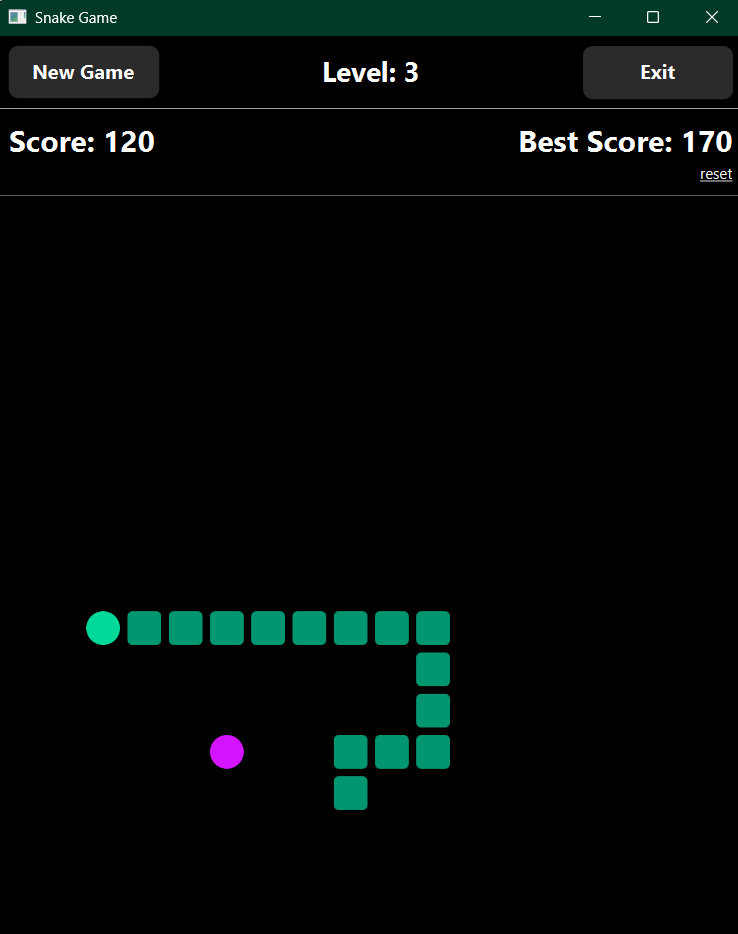

# Snake Game

A desktop Snake game built with Java, JavaFX, and Maven.

The project was created as a practical Java project to build a complete desktop game from scratch, including gameplay logic, persistent data, testing, packaging, and CI automation.

## Features

- Arrow keys and WASD controls
- Snake growth and random food generation
- Wall and self-collision detection
- Score and persistent Best Score
- Difficulty levels with increasing speed
- Start, New Game, Game Over, and Win states
- JavaFX CSS styling
- Unit tests with JUnit 5
- Windows `.exe` installer
- Linux `.deb` package
- GitHub Actions for CI and platform builds

## Screenshot



## Tech Stack

- Java 21
- JavaFX
- Maven
- JUnit 5
- JavaFX CSS
- `jpackage`
- WiX Toolset
- GitHub Actions

## Download

## Download

Download the latest release from [GitHub Releases](https://github.com/kzubko/snake-game/releases/latest):

- [Windows `.exe`](https://github.com/kzubko/snake-game/releases/latest)
- [Linux `.deb`](https://github.com/kzubko/snake-game/releases/latest)

## Run from Source

```bash
mvn javafx:run
```

## Run Tests

```bash
mvn test
```

## Build

```bash
mvn clean package
```

For detailed local packaging instructions for Windows and Linux, see [BUILDING.md](docs/BUILDING.md).

## Project Structure

```text
src/
├── main/
│   ├── java/
│   │   ├── Main.java
│   │   ├── Launcher.java
│   │   ├── Snake.java
│   │   ├── Food.java
│   │   ├── Point.java
│   │   └── Direction.java
│   └── resources/
│       ├── style.css
│       ├── icon.png
│       └── icon.ico
└── test/
    └── java/
        ├── SnakeTest.java
        └── FoodTest.java
```

## What I Learned

- Building a desktop UI with JavaFX
- Separating game logic, UI, drawing, and application state
- Writing unit tests with JUnit
- Storing persistent application data
- Packaging Java applications for Windows and Linux
- Automating tests and platform builds with GitHub Actions
